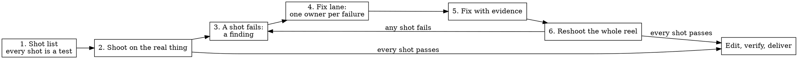

# The method: the reel is the acceptance test

A demo reel shows the product doing what a customer would want to see, shot by shot, on the real thing. Shooting it end to end is a stricter test than most suites, because a camera cannot be mocked: a slow ack, a half-loaded page, a flicker, or a clipped label is on the frame or it is not. The method treats every failed take as a bug report with footage attached.

## The loop

1. **Write the shot list.** What a customer would see, shot by shot. Each shot names its claim, its pass condition, and how the pass is measured. A shot without a measurable pass is a wish.
2. **Shoot it on the real thing.** The whole product, end to end, nothing mocked: the real daemon driving real hardware, the real CLI against its real demo world, the real web app on a real browser. Composed elements (titles, a score, a 3D render of real layout data) are allowed and are labeled as composed.
3. **A shot fails.** A failed take is a finding, not noise to retry past. Record it in the failure ledger before doing anything else, with the footage and the numbers.
4. **A fix lane.** One agent owns one failure until the cause is proven. Lanes run in parallel in their own worktrees; a lane that touches shared state (a database, a device, a build cache) names that resource and gets it to itself.
5. **The fix, with evidence.** Footage and commands a reviewer can rerun: the failing take, the passing take, the measurement before and after, and the test that fails without the fix.
6. **Reshoot.** The whole reel again, not only the fixed shot, until a full take passes. Fixes ripple: a changed default can alter how a later shot looks, and a demo world that learns to answer one command changes what an agent finds in the next take. [examples.md](examples.md) has both.

## The shot list

Write it before any capture code. One row per shot.

| #   | Shot (what the customer sees)                  | Claim it proves                 | Pass condition                                    | Measured by                       |
| --- | ---------------------------------------------- | ------------------------------- | ------------------------------------------------- | --------------------------------- |
| 03  | A new effect lands on every beat for 8 bars    | Effects switch live, in sync    | No frame over 20 ms; switch to pixels under 50 ms | Engine frame-time log, take video |
| 07  | The agent finds the offline AP from one prompt | An agent can diagnose with it   | Correct answer; only read-only commands; no retry | Take transcript, final frame      |
| 09  | The dashboard after the chart fills            | The chart shows a week of usage | Chart filled, no gaps, no placeholder text        | Still at 75 s, contact sheet      |

Rules for the pass column:

- **Budget every shot in the product's own units:** frame time against the configured FPS, ack latency, time to first paint, a correct answer. A runner that judges each shot against the configured FPS makes the first dress rehearsal honest; expect it to fail most shots.
- **Say what the pass measures and when.** "Page loaded" measured before data arrived is not a pass. See "check what the pass measured" in [verify.md](verify.md).
- **Every claim that appears on screen is a row.** A caption is a claim; it needs a measurement like any other. "Every brand" fails the moment one brand is unsupported, and an exact count goes stale as support grows; a list of names without a number stays true.

## The failure ledger

One entry per failed take, written when the take fails. Keep it in the project's tracker or a plain file the lanes can read; the format matters less than having one owner per row and evidence in every row.

| Field    | Content                                                                   |
| -------- | ------------------------------------------------------------------------- |
| ID       | Stable, e.g. `F-07`                                                       |
| Shot     | The shot it blocks                                                        |
| Symptom  | What the camera saw, in the viewer's words ("chart flashes on and off")   |
| Evidence | Take file and timestamp, frame number, log lines, the measurement         |
| Owner    | The one lane working it                                                   |
| Cause    | Filled in only when proven: a reproduction and a mechanism                |
| Fix      | Commit or PR, with before and after evidence                              |
| Reshoot  | The full take that passed with the fix, by file name                      |
| Status   | open, in lane, fixed, reshot (or parked, with the reason and who decided) |

Log a finding that does not block any shot as a side quest instead of a ledger row, and keep shooting. A ledger row that is really the harness (the camera, the runner, the measurement) is still a row. When a harness keeps guessing around the product's behavior, such as reconciling two clocks with heuristics, the fix often belongs in the product, such as a monotonic timestamp on its messages.

## A fix lane's definition of done

A lane is done when all of these hold:

1. **The cause is proven, not plausible.** A reproduction outside the reel shows the failure; the fix removes it; reverting the fix brings it back. Revert each fix once to watch the new test fail, then restore it.
2. **The evidence is rerunnable.** The commit or PR lists the commands, the before and after numbers, and the take files, ideally from an A/B on an isolated instance.
3. **The measurement measured the fix.** The A/B ran where the effect can show; on tmpfs, where fsync is free, a durable-write fix shows nothing.
4. **Someone else checked it.** An independent verifier read the change against the original failure; see [verify.md](verify.md).
5. **The ledger says so,** and the next full reshoot includes the shot.

A lane that finds the failure is out of scope (an upstream bug, a hardware limit) says so with evidence and parks the row with a named decision; it does not quietly retry until the take passes.

## Reshoot policy

- **Reshoot the whole reel.** A single-shot reshoot hides interactions between fixes and drifts the edit from what a viewer will see.
- **Keep every take.** Number takes and never overwrite one. Pin the exact take files the edit uses.
- **Compare before replacing.** A worse retake is not a better take. Judge takes on the shot's pass condition and the reel's honesty rules, then choose.
- **Never splice two runs under one timer** or reorder events to make a story. If a beat did not happen, drop it.
- **Stop when a full take passes,** then edit. If the edit exposes a new failure (a claim that is not true, a frame that shows private data), it goes in the ledger like any other.

## Brakes and the human bar

- **A sandbox for any agent on camera** ([agent-on-camera.md](agent-on-camera.md)). An agent that can reach real configuration will, eventually, on camera.
- **Protect the live system.** Run builds and renders under `nice` on a shared machine, one heavy job at a time; parallel compile lanes can drop a live product's frame rate mid-rehearsal and make the reel measure the build instead.
- **A human says when it is good.** Pipelines can certify size, frame rate, and color tags. Only a person can say "it did okay but I'm not wild about the result", and that verdict can send a finished cut back for a rebuild. Show them stills and a draft early; their taste is part of the acceptance test.
